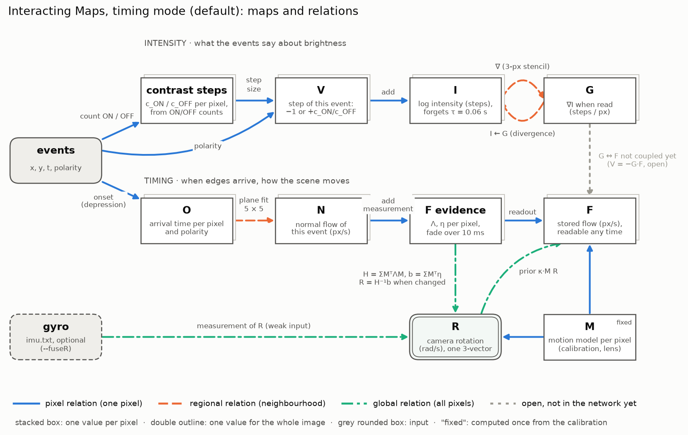

# Interacting Maps

An event-based C++ implementation of the Interacting Maps algorithm (Cook et al., IJCNN 2011). A small network of recurrently coupled, retinotopic maps (intensity I, gradient G, optical flow F, camera rotation R) relaxes from event-camera input towards a mutually consistent interpretation of the scene.

The original algorithm works on frames of accumulated events. This implementation updates the maps **per event** and treats the time between events at a pixel in closed form, so there are no time bins. No code was published with the paper; the implementation follows its description. Deliberate deviations from the paper are switchable and documented in [docs/cpp-implementation.md](docs/cpp-implementation.md).



The maps of the current network and the relations between them, by scope: pixel, regional (a neighbourhood) or global. Drawn by [docs/figures/network_graph.py](docs/figures/network_graph.py).

## Status

- **Milestone M0** (rework of the C++ implementation, see [TASKS.md](TASKS.md)) is largely done: known implementation flaws are fixed one commit at a time, each with a Catch2 regression test. The network now runs faster than real time (RTF ≈ 0.11 on `shapes_rotation`).
- **Rotation from event timing** (timing mode, the default since 2026-11-06): F gets evidence from the arrival times of edges at neighbouring pixels, and R is fitted to it in rad/s. On `shapes_rotation`, from events alone, R follows the gyro with median cos 0.992 and |R|/|ω| 0.995 (RTF 0.26). With `--legacy true`, the **legacy pipeline** runs instead: events are read as a step V with no time unit, so F and R have none, and R does not track the rotation. It is kept for comparison with the paper.
- The Python package (`python/`, `incomaps`: simulator, NumPy reference, generic engine) is still a scaffold (milestones M1–M3).

## Repository layout

| Path | Contents |
| --- | --- |
| `src/`, `include/`, `tests/` | Event-based C++ implementation, Catch2 tests |
| `python/` | Python package `incomaps`: simulator with ground truth, NumPy reference, evaluation (in progress) |
| `experiments/` | Offline experiments on recorded data (scripts and reports; results in `experiments/results/`, not tracked) |
| `docs/` | Paper summary, design, work-package specs, validation plan, notes on the C++ implementation, tests, assumptions |
| `configs/` | Network declarations (maps, relations, rates) |
| `res/<dataset>/` | Input data (see below) |
| `TASKS.md` | Milestones with acceptance criteria |

## Build and test (C++)

```
cmake -S . -B build -DCMAKE_BUILD_TYPE=Release
cmake --build build -j
ctest --test-dir build --output-on-failure
```

Requires OpenCV, HDF5 (with C++ bindings) and Eigen to be installed; Boost, Catch2, pybind11 and autodiff are fetched by CPM.

What the tests and experiments check: [docs/tests.md](docs/tests.md). Every assumption the network rests on, with its status: [docs/assumptions.md](docs/assumptions.md).

The default build computes the maps and writes `R.txt`. To also produce images (the V/I/G/F panels, a live window), build with `IMAGES` in a separate build directory:

```
cmake -S . -B build-images -DCMAKE_BUILD_TYPE=Release -DIMAGES=ON
cmake --build build-images -j
```

Both builds write the executable to `./InteractingMaps` in the repository root, so the build compiled last wins.

## Input data

The executable reads `res/<resourceDirectory>/` relative to the working directory. The format follows the [Event Camera Dataset](https://rpg.ifi.uzh.ch/davis_data.html) (e.g. `shapes_rotation`):

| File | Contents |
| --- | --- |
| `events.txt` | one event per line, `t x y p`: time in seconds, column, row, polarity 0/1; chronological; an optional header line is skipped |
| `settings.txt` | `height width` of the sensor, e.g. `180 240` |
| `calib.txt` | `fx fy cx cy k1 k2 p1 p2 k3` (pinhole intrinsics and radial-tangential distortion; the C++ model uses only the intrinsics) |
| `imu.txt` | `t ax ay az gx gy gz` (only with `--fuseR`) |
| `images.txt`, `images/` | frame list and frames (only with `--fuseI`) |

`events.txt` is large and not tracked; `.gitignore` excludes `res/shapes_rotation/events.txt`. The whole file is loaded into memory at start-up (about 2.4 s and 280 MB for 23 M events).

## Running

Run from the repository root. Results go to `output/<resultsDirectory>/`.

```
# Algorithm only, as fast as possible; prints the RTF in total and per 1 s interval
./InteractingMaps --startTime 0 --endTime 60 --resultsDirectory run1 --seed 0

# Rotation (rad/s) from event timing alone; R.txt can be compared with the gyro
./InteractingMaps --startTime 0 --endTime 60 --resultsDirectory run1

# IMAGES build: watch the network live, in real time, without writing PNGs
./InteractingMaps --startTime 0 --endTime 60 --show true --writeFrames false

# IMAGES build: write frames and turn them into a video
./InteractingMaps --startTime 0 --endTime 60 --resultsDirectory run1
ffmpeg -framerate 60 -pattern_type glob -i 'output/run1/VIGF_*.png' -c:v libx264 -pix_fmt yuv420p output/run1/run1.mp4
```

Each frame panel shows V (events since the last frame, red/green by polarity) top left, I top right, G bottom left and F bottom right; the colour wheel gives the direction of G and F. In timing mode, a plot below the panels shows the estimated angular velocity against the gyro over the last 10 s, and the 1 s rolling direction cosine and magnitude ratio over the whole run.

| Output | Contents |
| --- | --- |
| `R.txt` | time and R per output frame: rad/s in timing mode (R = −angular velocity, stored as y, x, z); "per event" units with `--legacy` |
| `time_realtime.txt` | processing time, data span and RTF (processing time / data time; < 1 is faster than real time; loading excluded) |
| `VLoss.txt`, `VIGF_*.png`, `frame_*.png` | IMAGES builds: consistency loss, panels and intensity per frame |

Main options (`./InteractingMaps --help` lists all):

| Option | Default | Meaning |
| --- | --- | --- |
| `--startTime`, `--endTime` | 0, 5 | time range of the recording in seconds |
| `--resourceDirectory`, `--resultsDirectory` | `shapes_rotation` | input under `res/`, output under `output/` |
| `--seed` | 0 | random initialisation and update order; runs are reproducible bit for bit |
| `--fps` | 60 | rate of output frames, live display and `R.txt` samples |
| `--show`, `--pace`, `--writeFrames` | false, true, true | IMAGES builds: live window, real-time playback, PNG output |
| `--asyncFR` | true | event-driven F ← R instead of global passes every `timeStep` |
| `--silentG` | true | time without events at a pixel counts as V = 0 for G |
| `--contrastSteps`, `--contrastRatio` | `pixel`, 1 | step of an ON event relative to an OFF event, c_ON / c_OFF: `equal`, `fixed` (the ratio), `global` or `pixel` (estimated from the event counts) |
| `--decay`, `--decayTime` | true, 0.06 | I forgets towards 0 with this time constant (s), derived from the error each event adds; see [forgetting.md](experiments/reports/forgetting.md) |
| `--silentRule` | `gradient` | what G does between events: `gradient` (G = ∇I when read), `rate` (former relaxation), `bound` (silence bounds G along F; falsified at edge fronts), see [silent-bound.md](experiments/reports/silent-bound.md) |
| `--clamp`, `--resetG` | false, false | deviations from the paper, see [docs/cpp-implementation.md](docs/cpp-implementation.md) |
| `--legacy` | false | run the legacy pipeline (F ← G, V and the F ↔ R loop; no units) instead of timing mode; see [docs/cpp-implementation.md](docs/cpp-implementation.md). Reports before 2026-11-06 write timing mode as `--rotationFromTiming true`. |
| `--randomInit` | false | start F and R random (inherited, for comparison) instead of at zero |
| `--onsetRule`, `--onsetTime` | `depression`, 0.02 | timing mode: arrival time per pixel (`latest`, `gap`, `depression`) and its time constant |
| `--evidenceLifetime`, `--evidenceAccumulate` | 0.01, false | timing mode: lifetime of flow measurements; add instead of replace |
| `--plotRotation` | true | IMAGES builds, timing mode: plot R against the gyro below the maps (display only; the gyro is not fused) |
| `--fuseR`, `--fuseI` | false | fuse the gyro (`imu.txt`) or the frames (`images.txt`) |

## Experiments (Python)

```
cd python && python3 -m venv .venv && .venv/bin/pip install -e ".[dev,fast]" && cd ..
PYTHONPATH=experiments python/.venv/bin/python experiments/v_units.py
```

| Script | Question | Report |
| --- | --- | --- |
| `experiments/v_units.py` | How should events be read as V = ∂ log I / ∂t? | [v-units.md](experiments/reports/v-units.md) |
| `experiments/r_prototype.py` | Rotation from event timing: does the F ↔ R loop settle to the steady state, and how fast? | [r-prototype.md](experiments/reports/r-prototype.md) |
| `experiments/onset_rules.py` | Which onset rule (latest event, burst gap, synaptic depression) gives the best arrival times? | [onset-rules.md](experiments/reports/onset-rules.md) |
| `experiments/polarity_check.py` | Does the network's G predict event polarity, sign(−G·u)? Needs a C++ run with `--dumpEvents` | [polarity-check.md](experiments/reports/polarity-check.md) |
| `experiments/contrast_steps.py` | Do separate ON/OFF contrast steps (c_ON ≠ c_OFF) make the I decay unnecessary? | [contrast-steps.md](experiments/reports/contrast-steps.md) |
| `experiments/forgetting.py` | How much error does each event add to I, and how fast must I forget? | [forgetting.md](experiments/reports/forgetting.md) |
| `experiments/polarity_check.py` with `--silentRule` runs | What should a silent pixel do to G: relax with rates, follow ∇I, or obey the bound that silence gives? | [silent-bound.md](experiments/reports/silent-bound.md) |

`experiments/event_maps.py` holds the shared maps and relations (event index, onset rules, normal flow) behind small interfaces, so rules can be swapped.

# Installation (manual dependency setup)
```
mkdir external && cd external
```
## Install Eigen
```
cd external
git clone https://github.com/PX4/eigen.git
```
enough to use the libraries as eigen is header only
```
cd eigen
mkdir build && cd build
cmake ..
sudo make install
```
## Install boost
CMake
## Install Catch2
```
git clone https://github.com/catchorg/Catch2.git
cd Catch2
git checkout v3.9.1
mkdir build && cd build
cmake -DCMAKE_INSTALL_PREFIX=/usr/local ..
```
## Install pybind11
```
cd external
git clone https://github.com/pybind/pybind11
cd pybind11/
mkdir build && cd build
cmake -DCMAKE_INSTALL_PREFIX=/usr/local ..
```
## Install autodiff
```
cd external
git clone https://github.com/autodiff/autodiff
mkdir .build && cd .build
cmake ..
cmake --build . --target install
```

## Install dv-processing
https://gitlab.com/inivation/dv/dv-processing
### Clone repo
```
git clone https://gitlab.com/inivation/dv/dv-processing.git
cd dv-processing
```
### Build
Create the /opt/dv-processing if necessary
```
mkdir build && cd build
CC=clang CXX=clang++ cmake -DCMAKE_INSTALL_PREFIX=/opt/dv-processing ..
make -j4 -s
make test
```
### Install Headers
```
sudo make install
```


-D AUTODIFF_BUILD_PYTHON=OFF  # <-- Add this line to the ```cmake -S . -B build -G Ninja...``` command to disable Python bindings
pybind11 is then probably not needed. Otherwise python makes trouble

## H5pp
HDF5 fork
### Get the source
git clone -b dev https://github.com/DavidAce/h5pp.git h5pp-source

### Run CMake configure (optionally do this with cmake-gui)
### CMake version > 3.15 is required!
### h5pp will be installed side by side with the project directory
### H5PP_PACKAGE_MANAGER=none will skip finding dependencies

cmake -DCMAKE_BUILD_TYPE=Release \
-DCMAKE_INSTALL_PREFIX=h5pp-install \
-DBUILD_SHARED_LIBS=OFF \
-DH5PP_PACKAGE_MANAGER=none \
-DH5PP_ENABLE_EIGEN3=ON \
-DH5PP_ENABLE_SPDLOG=ON \
-DH5PP_ENABLE_TESTS=OFF \
-DH5PP_PRINT_INFO=ON \
-S h5pp-source \
-B h5pp-build

### Install the headers and other files to the location specified in CMAKE_INSTALL_PREFIX
cmake --build h5pp-build --parallel 4 --config Release  --target install

## Acknowledgements

 - M. Cook, L. Gugelmann, F. Jug, C. Krautz and A. Steger, "Interacting maps for fast visual interpretation," The 2011 International Joint Conference on Neural Networks, San Jose, CA, USA, 2011, pp. 770-776, doi: 10.1109/IJCNN.2011.6033299.


## Authors

- [@Daniel Pommer](https://www.github.com/DanielBanana)

