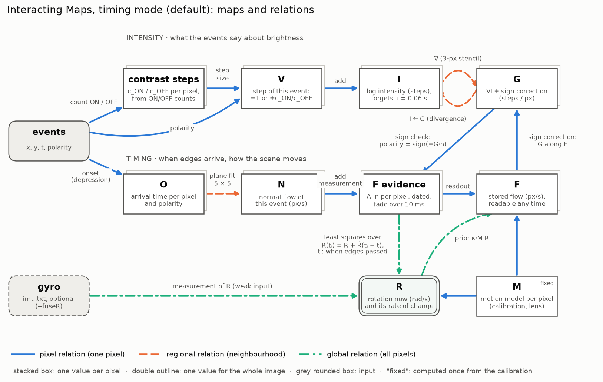

# Event-based C++ implementation

The C++ code in `src/` and `include/` predates the specs in this folder. It runs the paper's update rules **per event** instead of per binned frame. This file maps it onto `paper-summary.md`, lists where it deviates on purpose, and records known issues. Fixes are tracked under M0 in `TASKS.md`.

## Map layout

| Paper | C++ (`OpticalFlowState`) | Shape | Notes |
| --- | --- | --- | --- |
| V | `V` (scalar per event), `V_Vis` (display only) | H × W | `V = polarity · eventContribution` = ±1, polarity ∈ {−1, +1} |
| I | `MI` | H × W | log intensity in units of the OFF threshold c_OFF (event steps), offset 0; an ON event adds c_ON / c_OFF (`--contrastSteps`, default per pixel from the event counts); shown from −5 (black) to +5 (white) steps |
| I | `MI` | H × W | Not (H+1) × (W+1); see deviations |
| G | `G` | H × W × 2 | channel 0 = y, channel 1 = x |
| F | `F` | H × W × 2 | channel 0 = y, channel 1 = x |
| C | `CCM`, with tangents `dCdx`, `dCdy` | H × W × 3 | 3-vectors stored as (y, x, z); pinhole from fx, fy, cx, cy, no distortion |
| R | `R` | 3 | stored as (y, x, z) |

Camera frame: x right, y down, z forward (right-handed), as in `CLAUDE.md`. 3-vectors are stored in the order (y, x, z); `crossProduct3x3` and `crossProduct1x3` permute indices so that they compute the right-handed cross product of the underlying (x, y, z) vectors. F and G channel 0 point down (increasing row). R is the paper's R, i.e. minus the camera rotation; the test "F = m32(R x C) with R = -(camera rotation) reproduces projected pixel motion" pins this down against explicit pinhole projection.

## Update functions

Names read "target from source": `update_FG` updates F from G. This is the reverse of the `delta_AB` convention in `CLAUDE.md` (A → B); the C++ names are kept to avoid churn.

| Paper direction | Function | Scope |
| --- | --- | --- |
| G, V → F | `update_FG` | event pixel |
| F, V → G | `update_GF` | event pixel |
| I → G | `update_GI` | event pixel and its 4 neighbours |
| G → I | `updateGIDiffGradient` + `update_IG` | event pixel |
| R → F | `relaxB` + `relaxFR` (default, `--asyncFR`) or `update_FR` | event-driven closed form (see below); synchronous: all pixels, `updateIterationsFR` times per `timeStep` |
| F → R | `update_RF` | incremental least squares (running sums `A`, `B`) |
| gyro → R | `update_RIMU` | per IMU sample |
| frame → I | `update_Ifusion` | per image |

Per event, `decayNeighbourhood` first decays every pixel within Manhattan distance 2 of the event to the event time (decay is lazy; the gradient stencils of `event_step` read all of them). `event_step` then applies V → I, then I → G around the pixel, then G → I, then F/G/R updates in a shuffled order.

## Deliberate deviations from the paper

Kept as defaults; each can be switched off (field in `Parameters`, command-line option in brackets):

| Deviation | Switch | Off means |
| --- | --- | --- |
| **V → I injection.** Each event adds `weight_IV · V` (±1, i.e. Δlog I = ±c) to `MI`. Not clipped since 2026-11-06 (the former [0, 255] with step 10 and neutral 128 was an 8-bit display mapping). The paper never observes I directly. | `weight_IV` | `weight_IV = 0` |
| **Decay.** `MI` decays exponentially towards `neutralPotential` (0) with time constant `decayParam` = 0.06 s, derived from the error each event adds (`experiments/reports/forgetting.md`). | `useDecay` (`--decay`) | no decay |
| **Clamping**, **off by default** since 2026-11-06. F and G are clipped to ±`gamma` (255, the old display range) and entries below `eps` are zeroed after each update. | `clampMaps` (`--clamp`) | no clipping, no zeroing |
| **Per-frame G reset** when built with `IMAGES`: G is zeroed after each output frame. Old workaround for stale G, superseded by silent-time relaxation below; **off by default**. | `resetGEachFrame` (`--resetG`) | G keeps its state |
| **Central differences** for ∇I on an H × W grid instead of forward differences on (H+1) × (W+1). | none | — |

## Weights and rates

All relation weights default to 1 (2026-11-02): each update solves its relation's local constraint exactly, with no damping, until there is a reason for another value. The earlier values (0.2, 0.8) had no documented justification. The inputs `weight_RIMU` and `weight_Ifusion` stay 0 (off); 1 would clamp R to the gyro or I to the frame (rule 5).

The continuous-time rates (`rate_GI_silent`, `rate_GF_silent`, `rate_FR`, in 1/s) are independent parameters. They have no neutral value: a weight of 1 per step corresponds to an infinite rate, i.e. a hard constraint, and two competing hard constraints at a silent pixel (G ← I and G ← F) are ill-defined. They keep their former values (−ln(1 − 0.2)/10 ms and −4 ln(1 − 0.8)/10 ms) and are open (M2).

## Pixels without events (asynchronous V = 0)

Default since 2026-11-06: `--silentRule gradient`, G = ∇I wherever it is read, with no rates (`experiments/reports/silent-bound.md`). The rate relaxation below is kept as `--silentRule rate`; in timing mode it gives the same result.

In the paper every pixel is updated every iteration, and a pixel without events has V = 0: an observation ("brightness did not change"), not missing data. Event-driven updates alone never touch such pixels, so G stayed wherever the last edge left it.

Instead of a per-bin sweep, each pixel stores `GTimeSurface`, the time up to which its G is current. Before `event_step` reads G at the event pixel and its 4 neighbours, `relaxSilentNeighbourhood` integrates the two relations the paper applies at a silent pixel over the elapsed time, in closed form:

- G ← I: G relaxes towards g = ∇I (from the freshly decayed stencil) at rate `rate_GI_silent`.
- G ← F with V = 0: G's component along F decays at rate `rate_GF_silent`.

Split along F, the perpendicular part goes to g⊥ with rate `rate_GI_silent`, and the parallel part goes to `rate_GI / (rate_GI + rate_GF) · g∥` with rate `rate_GI + rate_GF`. The solution is exact for g and F constant over the silent time; both are approximations (an event two pixels away can change ∇I, and global F ← R updates change F). Output frames show `relaxedSilentCopy(G)`, every pixel relaxed to the frame time, without changing the state.

The rates default to `-ln(1 - weight) / time_step`, which reproduces one paper update per time step (tested). They are open parameters, to be determined by the M2 sweeps. Switch: `silentRelaxation` (`--silentG`). F is not relaxed over silent time; it is regularised globally by F ← R.

## Event-driven F ← R

The synchronous version applies `update_FR` `updateIterationsFR` times to every pixel each `timeStep` and then rebuilds the F → R sums, O(pixels) at 100 Hz, which dominated the run time. In the event-driven version (`asyncFR`, default):

- F at a pixel relaxes towards m32(R × C) at rate `rate_FR = -updateIterationsFR · ln(1 - weight_FR) / timeStep` (one time step reproduces the synchronous passes; tested). `relaxFR` applies this lazily, with the current R, where an event reads F (event pixel and its 4 neighbours) and for display (`relaxedFRCopy`).
- B = Σ (I − CCᵀ)(C × m23(F)) is linear in F, and a relaxed pixel contributes (I − CCᵀ)R. So B relaxes in closed form, B ← A R + (B − A R) e^(−rate_FR dt), in O(1) per event (`relaxB`). This is exact because R only changes at events. `relaxFR` refreshes `old_points` without touching B.
- After each event step, `register_R_point` puts the final F of the event pixel into B (F ← G may run after F → R within the step).

Approximation: `relaxFR` uses the current R for a pixel's whole silent time, while B integrated the actual R history. The two differ only through R changes within the last few 1/rate_FR (≈ 1.6 ms).

Output frames, the live window (`--show`) and `R.txt` samples run at `--fps` (default 60), independent of `timeStep`.

## Rotation from event timing (timing mode, default)

The default since 2026-11-06; `--legacy true` runs the pipeline of the paper instead (formerly the default; `--rotationFromTiming true` selected this mode).

The mode that replaces the per-event F ← G, V and G ← F, V and the F ↔ R loop. The maps and relations live in `include/timing.h` / `src/timing.cpp`. Each map is a struct and each relation a function that takes only the maps it reads and writes, so relations can be swapped or added (e.g. a translation model next to the rotation model).

| Map / relation | Implementation | Default |
|---|---|---|
| events → O (arrival time per pixel and polarity) | `OnsetRule`: `LatestEventOnset`, `HardGapOnset`, `DepressionOnset` (short-term depression: O ← O + r(t − O), r recovers with τ) | depression, τ = 20 ms (`--onsetRule`, `--onsetTime`) |
| O → N (normal flow) | `fitNormalFlow`: plane fit to the same-polarity neighbours' arrival times; speed in px/s, variance from the residuals | 5 × 5, horizon 30 ms, time floor 0.1 ms |
| N → F evidence | `FlowEvidence`: information form Λ = Σ w n nᵀ, η = Σ w n s per pixel, w = 1/σ², fading with the lifetime | replace, lifetime 10 ms (`--evidenceAccumulate`, `--evidenceLifetime`) |
| G, polarity → F evidence | `directionProbability`: polarity = sign(−G·F); a measurement's information is multiplied by the probability that its direction is right, given polarity and G (σ_G = 0.5 steps/px, π = 0.1) | `weight` (`--polaritySign`) |
| F, polarity → G | `correctGradientSign`: G's component along F moved to its posterior mean given the polarity (σ_G, ρ = 0.96); kept as δG on top of ∇I, forgetting with τ | on (`--signCorrectG`) |
| R now | `RotationFromFlow::rotationAt`: measurements dated at their onsets (`NormalFlow::time`), least squares over R and Ṙ with time moments; solved at most every 1 ms, extrapolated in between | on (`--predictRotation`) |
| F evidence → R | `RotationFromFlow`: H = Σ MᵀΛM, b = Σ Mᵀη as running sums that fade as a whole in O(1); R = H⁻¹b in rad/s, solved only when new evidence arrived and R is read | — |
| gyro → R | `RotationFromFlow::addMeasurement`: a measurement of R with weight 1/σ², fading like the evidence; a weak input | σ = 0.05 rad/s, with `--fuseR` |
| R → F | `readFlow`: F = (Λ + κI)⁻¹(η + κMR), written into the stored F map where an event reads it and at every output frame; the prior never enters the evidence | κ = 1/(27 px/s)² |
| motion model | `MotionModel::rotation`: M per pixel through the lens model (radial-tangential distortion); without distortion it equals F = m32(R × C) | — |

I and G are updated as before (V → I, I ↔ G, silent G relaxation, which now reads the stored F). In this mode R is in rad/s, R = −(camera angular velocity), stored as (y, x, z).

On `shapes_rotation` (60 s, events only), R against the gyro, per 1/60 s frame (|ω| > 1 rad/s): median cos 0.992, mean 0.938, |R|/|ω| 0.995 [0.86, 1.14], per-axis correlation 0.956 / 0.963 / 0.954, at RTF 0.26. This reproduces the Python prototype exactly (`experiments/reports/r-prototype.md`, `onset-rules.md`). With `--fuseR`: mean cos 0.941. All parameter values are open (sweep on the simulator, M1).

## Known issues

See M0 in `TASKS.md` for the full list and status, and [assumptions.md](assumptions.md) for every value the network rests on.

- **Legacy pipeline (`--legacy true`): R has no physical unit and does not track the camera rotation** (correlation with the gyro below 0.25). V is a step per event, not a temporal derivative, so F is in px per event; a pixel's event rate does not carry the speed on this sensor (`experiments/reports/v-units.md`). `update_RIMU`'s `imuScale` is therefore undefined. Timing mode solves this for F and R (rad/s, cos 0.99 against the gyro).
- **I drifts without the decay:** OFF events outnumber ON events 1.36 : 1 per pixel, i.e. c_ON ≈ 1.36 c_OFF; the decay (τ = 0.06 s, derived in `experiments/reports/forgetting.md`) forgets the error each event adds (`experiments/reports/polarity-check.md`).
